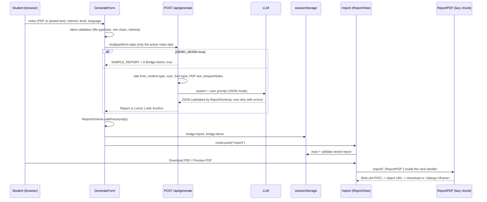

# Bridge — architecture

Bridge turns lecture notes plus a personal interest ("football tactics", "baking") into a study
report: the key concepts, an analogy for each with an honest note on where it breaks, a concept
map, a quiz and next steps. The report is shown as a web page and can be downloaded as an A4 PDF.

## Stack

| Layer | Choice | Notes |
| --- | --- | --- |
| Framework | Next.js 14.2.35, App Router | Must stay on 14 with React 18 |
| Language | TypeScript (strict) | `@/*` path alias to the repo root |
| Styling | Tailwind CSS 3 | Colour tokens as CSS variables, light/dark via `prefers-color-scheme` |
| Validation | Zod 4 | `ReportSchema` is the single contract between LLM, API and UI |
| LLM | OpenAI SDK (any compatible endpoint) | Server-only, skipped entirely in demo mode |
| PDF input | pdf-parse | Server-only text extraction |
| PDF output | @react-pdf/renderer 4.9 | Runs in the browser only |
| Motion | Motion (`motion/react`) 14.1 | Formerly Framer Motion; one global `MotionConfig reducedMotion="user"` |
| Storage | `sessionStorage` | No database, no auth: a report lives in the tab that made it |

## Repository map

```
app/
  layout.tsx              Root layout: self-hosted fonts (next/font/local), MotionProvider
  globals.css             Design tokens (light + dark), DejaVu fallback for science symbols
  fonts/                  Young Serif, Work Sans, IBM Plex Mono (TTF) + OFL licences
  page.tsx                Landing page
  report/page.tsx         Report page (server component): picks sample or stored report
  api/generate/route.ts   POST /api/generate                                     [frozen]
components/
  GenerateForm.tsx        The landing form: inputs, client validation, submit, storage
  LoadingSteps.tsx        Timer-driven four-step loading state (aria-live)
  ReportView.tsx          The report page UI: concepts, map, quiz, next steps, PDF actions
  ConceptMapDiagram.tsx   Concept map as inline SVG (+ text list alternative)
  ReportPDF.tsx           <ReportPDF report> and reportPdfBlob(report) — loaded on demand
  MotionProvider.tsx      Reduced-motion policy for every Motion animation
lib/
  types.ts                Zod schemas: Report, GenerateInput, ApiError              [frozen]
  constants.ts            Limits and storage keys shared by form and API
  sample.ts               SAMPLE_REPORT (English) and SAMPLE_REPORT_TR (Turkish)
  labels.ts               Fixed report words in en/tr, shared by page and PDF
  concept-map-layout.ts   Pure layout function shared by the SVG and the PDF
  llm.ts, prompt.ts       LLM call, prompts, validation and one corrective retry    [frozen]
  notes.ts, pdf.ts        Note clean-up/shortening and PDF text extraction           [frozen]
  rate-limit.ts           In-memory per-IP limiter                                   [frozen]
public/fonts/             DejaVu Sans regular/bold TTF + licence (PDF font)
scripts/self-check.test.mjs   `npm test`
```

"Frozen" files are the finished backend. UI work must not change them; suspected bugs in them are
reported, not fixed.

## Request flow



### The API (frozen)

`POST /api/generate` takes `file` (PDF, ≤ 10 MB) and/or `text`, plus `interest`, `level`
(default `undergraduate`) and `language` (`en` | `tr`). It answers `200` with a `Report`, or
`{ "error": string }` with 400, 413, 415, 422, 429 or 5xx. Notes over 15 000 characters are
shortened section by section (`X-Bridge-Notes-Truncated: true`).

Important consequence for the UI: in demo mode the route returns the English sample **before any
validation**. Every error the user must see in demo mode (no notes, a non-PDF file, too-short text,
missing interest) is therefore caught in `GenerateForm` before the request is sent. In demo mode the
chosen report language is also ignored (the sample is always English); the report page says it is
a demo.

## Data contract

`lib/types.ts` defines `ReportSchema`; every TypeScript type is inferred from it.

```
Report
  title, interest, language ("en" | "tr"), summary
  concepts[4..6]: id, name, lecture_explanation, bridge_title, bridge_explanation,
                  analogy, analogy_limits, example, misconception, strength (1..5)
  concept_map: nodes[≥2] {id, label, type: "lecture" | "interest"}
               edges[≥1] {from, to, label}   (ids must exist, no duplicate node ids)
  quiz[5]: question, options[4], answer_index (0..3), explanation
  next_steps[3]
```

The schema validates structure only. Text lengths, node counts, self-loops, duplicate edges and
single-column maps all pass it, so the layout and the PDF never assume sizes.

## Client state

| Key | Written by | Read by | Meaning |
| --- | --- | --- | --- |
| `bridge:report` (`REPORT_STORAGE_KEY`) | GenerateForm | ReportView | The validated report JSON |
| `bridge:demo` (`DEMO_FLAG_STORAGE_KEY`) | GenerateForm | ReportView | `"true"` when the reply had `X-Bridge-Demo: true`; always rewritten, so a later real report clears it |

`/report?sample=1` and `/report?sample=tr` bypass storage and show `SAMPLE_REPORT` /
`SAMPLE_REPORT_TR`. The page passes the sample object as a prop and keys `ReportView` on the
sample value, so switching samples remounts it. The demo note is shown only for stored reports.
With nothing stored, ReportView shows an empty state with links to the form and both samples.

## Components

**GenerateForm** owns all landing state in React state (both tabs keep their content, so an error or
a tab switch never loses input). Validation mirrors the server limits from `lib/constants.ts`; the
PDF check copies `looksLikePdf` from `lib/pdf.ts` because that module is server-only (it imports
pdf-parse). Submit builds `FormData` from state, awaits `Promise.all([request, delay(2500)])` so the
loading sequence shows for at least 2.5 s, maps non-JSON error bodies by status, validates the reply,
writes storage (with its own error message if storage is blocked) and navigates.

**LoadingSteps** advances "Reading notes → Finding concepts → Building bridges → Making your PDF" on a
timer and holds on the last step. After 12 s it adds a calm "still working" hint and an elapsed
counter that sits outside the `aria-live` region, so screen readers hear each step once, not every
second.

**ReportView** renders the header (interest, title, summary), one section per concept with every
field, the strength as 1–5 with a spoken label, "Where the analogy breaks" as the single highlighted
element, the concept map, the interactive quiz (A–D, non-colour feedback, per-question `aria-live`),
next steps, and the PDF actions. All fixed words come from `LABELS[report.language]`, and the root
carries `lang={report.language}`.

**PDF actions.** "Download PDF" imports `./ReportPDF` inside the click handler, calls
`reportPdfBlob(report)`, downloads through a temporary `<a download>`, and revokes the URL after
60 s (revoking at once can cancel the download in some browsers). "Preview PDF" (md and wider only,
since embedded viewers are unreliable on phones) shows the same blob in an `<iframe>` inside a native
`<dialog>` opened with `showModal()`; closing returns focus to the trigger and revokes the URL.

**ConceptMapDiagram** draws `layoutConceptMap(map)` as inline SVG with a `viewBox`, an HTML legend, a
horizontally scrollable frame on phones (the text never shrinks below readable size) and a
`<details>` list of every edge as the text alternative.

## Shared modules

### `lib/labels.ts`

One dictionary, `LABELS: Record<Language, ReportLabels>`, holds every fixed word of a report in
English and Turkish (section names, field labels, button text, `pageOf(page, total)`,
`strengthOutOf(n)`), plus `formatReportDate(language)` and `optionLetter(index)`. Both the page and
the PDF import it, so they always agree. Avoid CSS/`toUpperCase` uppercasing of Turkish text
(dotless/dotted i).

### `lib/concept-map-layout.ts`

A pure, dependency-free function (`import type` only, so Node can run it directly in the
self-check) that returns everything both renderers need, in abstract units on a 640-wide canvas:

- **Columns.** Lecture nodes on the left, interest nodes on the right, 140 wide, with a 115-unit
  outer margin on each side for curves.
- **Order and alignment.** The longer column stacks top-down. Each node in the other column lines
  up with the first partner it links to, and the partner's slot is made tall enough for it, so most
  "is like" edges become level lines.
- **Ports.** Edge ends on one side of a node are spread over its height, ordered by where the other
  end is, so lines and arrowheads do not pile up.
- **Edges.** Between columns: straight lines. Within a column: cubic curves bowing outward on one of
  three bulge tracks, assigned so curves with overlapping vertical ranges nest instead of
  colliding. Self-loops: a small outward loop.
- **Labels.** Every node and edge label is wrapped by character count (0.6 em estimate; the
  self-check measures real DejaVu widths against it; over-long words are split with a hyphen).
  Edge labels are placed at a parameter near the middle of their line, trying several positions and
  picking the one that overlaps nothing (covering a node is weighted far worse than touching another
  label).
- **Output.** Node boxes with text lines and first baselines, edge `path` data, arrowhead polygons,
  label boxes, font sizes and line heights.

### `lib/sample.ts`

`SAMPLE_REPORT` (chemical equilibrium bridged to football tactics) and its faithful Turkish
translation `SAMPLE_REPORT_TR` with identical ids, strengths, edges and answer positions. The
English sample is also what demo mode returns.

## PDF generation (`components/ReportPDF.tsx`)

- **Browser-only.** The module touches `window` at load and is only ever reached through a dynamic
  import in a click handler, so it never runs during server rendering or `next build`.
- **Fonts.** DejaVu Sans regular and bold, registered from `public/fonts` by absolute same-origin
  URL. It covers Turkish letters and the science symbols (⇌ → ≠ − × Δ ₂ ₄ ² ³); `npm test` proves it
  with fontkit. Hyphenation is switched off (`Font.registerHyphenationCallback(w => [w])`).
- **Pages (A4).** Cover (wordmark "Bridge", title, interest, localised date, no footer) → summary →
  one page per concept (fields flow onto the next page; labels use `minPresenceAhead` and are
  siblings of their text so a label is never stranded) → concept map → quiz (A–D, no answers) →
  answer key → next steps.
- **Footer.** "Bridge" and `LABELS.pageOf(n, total)` on every page but the cover. It is positioned
  from the top (`top: A4_HEIGHT - 52`) because, in this react-pdf version, a bottom-anchored box
  holding a render-prop text is drawn far above the page.
- **Map.** The same layout drawn with react-pdf `Svg` primitives (`Path`, `Polygon`, `Rect`, one
  `Text` per pre-wrapped line). SVG text reads its font from props, so the font is set on a wrapping
  `G`; without it Helvetica would drop Turkish letters. A map taller than the free page height is
  scaled down proportionally instead of being cut off.
- **Palette.** A fixed light palette that matches the web tokens (the PDF is always light).

## Design system

- **Tokens** (`app/globals.css`, exposed through `tailwind.config.ts`): `background`, `foreground`,
  `card`, `muted`, `border`, `lecture` (ink blue), `interest` (notebook-margin red), `interest-ink`,
  `on-lecture`, `highlight` (highlighter yellow, a background only), `danger`, `success`. Each is an
  RGB triple, so opacity modifiers work; dark values switch under `prefers-color-scheme: dark`.
- **Fonts** (self-hosted, OFL): Young Serif for headings, Work Sans for UI and body, IBM Plex Mono for
  small numerals. A `Bridge Symbols` `@font-face` maps ⇌, arrows, maths operators, Δ and
  sub/superscripts to the bundled DejaVu file, which the browser downloads only when a page uses them.
- **Motion.** Interaction-only: press feedback, sliding selection indicators, quiz feedback,
  dialog. Springs are critically damped (`bounce: 0`). Content is never hidden behind a page-load
  entrance animation. `MotionConfig reducedMotion="user"` drops transforms for users who ask for
  reduced motion; CSS animations use `motion-safe:`.
- **Anti-patterns banned by the design brief:** gradients, glows, pill chips, status dots,
  coloured side-stripe borders, badges above headings, all-caps labels, cards around everything.

## Verification

| Check | How |
| --- | --- |
| Types and lint | `npx tsc --noEmit -p .`, `npm run lint` |
| Production build | `npm run build` |
| Self-check | `npm test` → `scripts/self-check.test.mjs` (Node 24 runs the TS modules directly through a small resolve hook): both samples pass `ReportSchema`; the map layout stays readable for both samples, a 14-node/20-edge map and a single-column map with a loop (no overlaps, on canvas, lines fit real DejaVu widths, fits one A4 page); the PDF fonts have a glyph for every character in the samples and labels |
| PDF content | A Node harness (not part of the repo) renders both samples and a stress case, then checks with pdf-parse that every report string is present, every page after the cover has the right "page N of Y", and the Turkish and science glyphs appear |
| UI | Browser in demo mode at 375 px and desktop, light and dark; the two error states; PDF preview pages |

## Known limits

- Demo mode skips all server validation (by design of the frozen route); client checks cover it.
- The rate limiter is in-memory per process; Vercel rejects bodies over 4.5 MB before the route sees
  them, and the route's 120 s `maxDuration` needs Fluid compute on Vercel Hobby.
- Characters outside DejaVu Sans (for example emoji in a real LLM reply) would render as empty boxes
  in the PDF.
- A word longer than a whole line is not split in the PDF body text, because hyphenation is off.
- Reports live only in the tab's `sessionStorage`; closing the tab loses them.
